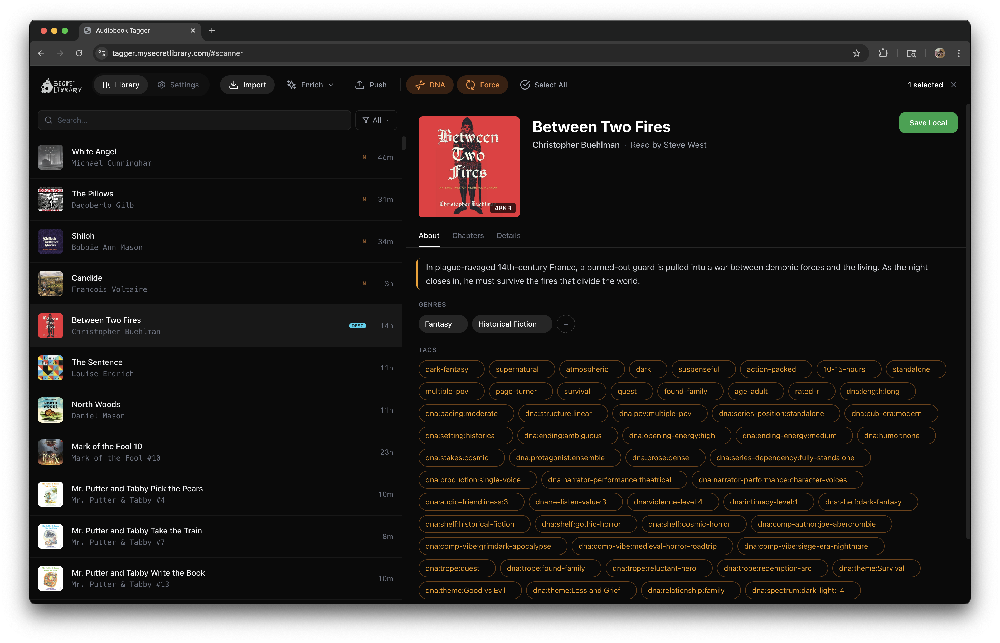

# Audiobook Tagger

Metadata manager for [AudiobookShelf](https://www.audiobookshelf.org/) with AI enrichment. Connect to your ABS server, let AI suggest genres, tags, descriptions, DNA fingerprints and fixes for titles, authors and series, review the changes, then push them back. You can also scan a folder of audio files on your computer and write tags into them (desktop app only). AI can be cloud (OpenAI, Anthropic) or local through Ollama.



## Download

| Platform | Link |
|----------|------|
| Windows | [Latest release](https://github.com/philipvox/audiobook-tagger-refactored/releases/latest) (.msi or NSIS .exe installer) |
| macOS (Apple Silicon) | [Latest release](https://github.com/philipvox/audiobook-tagger-refactored/releases/latest) (.dmg aarch64) |
| macOS (Intel) | [Latest release](https://github.com/philipvox/audiobook-tagger-refactored/releases/latest) (.dmg x64) |
| Linux | [Latest release](https://github.com/philipvox/audiobook-tagger-refactored/releases/latest) (.deb, .rpm, or .AppImage) |

[All releases](https://github.com/philipvox/audiobook-tagger-refactored/releases)

## Features

- **AI enrichment:** Genres, tags, DNA fingerprints, descriptions, and fixes for titles, subtitles, authors, series and narrators, from the Enrich menu.
- **Three AI providers:** OpenAI (default model GPT-5 Nano), Anthropic Claude, or local AI through Ollama with no API key.
- **ABS integration:** Import your library and push enriched metadata back to your server. Push sends only the fields you changed since import, and merges tags and genres with what is on the server.
- **Local folder scanning:** Scan folders of M4B or MP3 files on your computer, then write tags and rename files (desktop app only, see below).
- **Local Whisper:** Check by Audio transcribes a book's intro to pick out the title, author and narrator.
- **Batch processing:** Chunked runs with progress and Cancel.
- **Configurable concurrency:** ABS Push Workers, 1 to 10, default 3.

## Setup

### Connect to AudiobookShelf

1. Open Settings.
2. Enter your ABS server URL (HTTP or HTTPS) and API token.
3. Click "Connect & Detect Libraries".
4. On the Library screen, click Import.

### Cloud AI

1. Go to Settings > AI Provider.
2. Enter an OpenAI or Anthropic API key and choose a model.

API keys are stored in the webview's local storage in plain text and sent only to the AI provider. See [SECURITY.md](SECURITY.md).

### Local AI (Ollama)

1. Go to Settings > Local AI.
2. Click "Install Local AI", or use an Ollama you already run. The app installs a pinned Ollama release, verified by SHA-256, and downloads the model you pick. Gemma 4 E4B is the recommended preset (about 9.6 GB); Gemma 4 E2B (about 7.2 GB) and Qwen 3 4B (about 2.6 GB) are smaller.
3. Turn on the "Use Local AI" switch. It works with an Ollama started outside the app too.

Classification and the other AI actions then run on your machine with no API key. The Ollama install on Windows is manual (download from ollama.com).

### Local Whisper (Check by Audio)

Settings > Local Whisper has "Install Local Whisper" and a "Use Local Whisper" switch.

- **macOS:** whisper-cpp and FFmpeg are installed through [Homebrew](https://brew.sh), which must already be installed.
- **Windows:** the app downloads whisper.cpp and FFmpeg (pinned and SHA-256 verified).
- **Linux:** whisper-cpp is installed through Homebrew, and the app downloads a pinned static FFmpeg build.
- Whisper models are downloaded from Hugging Face on request.

## Local folders

On an empty Library screen, choose "Scan a local folder". Once a library is loaded, use "Scan Folder" in the action bar. Both are in the desktop app only.

- **Write Tags** writes your staged changes into the selected locally scanned files. A preview shows the exact changes first. Fields written: title, author, narrator, genre, series and part number, description, subtitle, publisher, language and year, in the formats the writer supports. **Tags and DNA are app-only for local files:** they are never written into the audio files, and the write preview marks them as such.
- **Rename** renames the selected local files from a template, with a preview. **Rename cannot be undone from the app.**
- **Undo last write** restores the files changed by the most recent tag write from their backups. It appears while an undo journal exists, and only the last write can be undone.
- **Push skips local books.** Push is for books imported from ABS. A locally scanned book is written with Write Tags instead.
- Write Tags and Rename act on locally scanned books only, never on books imported from ABS.

## AI behaviour you should know about

- Classify keeps a book's existing genres and adds AI suggestions by default. The option is in Settings ("Keep existing genres and add AI suggestions"); turn it off to let AI replace them.
- AI tags and DNA are merged into a book's existing tags rather than replacing them.
- Truncated or empty AI answers are rejected, not applied.
- Nothing is pushed automatically. Review, then click Push.

## NAS Users

If your ABS server runs on a NAS and struggles during push operations, set ABS Push Workers to 1 in Settings > Performance (1 to 10, default 3). Raise it on a fast server.

## Platform notes

- The Windows and Linux installer paths for Whisper, FFmpeg and Ollama were verified against the release archives but were not run on those platforms in this release.
- Builds are not notarized (macOS) or code-signed (Windows). Expect an operating-system warning on first launch. Each release has `SHA256SUMS-<platform>.txt` files you can check a download against.


## Building from Source

Requires [Node.js](https://nodejs.org/) 18+, [Rust](https://www.rust-lang.org/tools/install) stable, and [Tauri 2 prerequisites](https://v2.tauri.app/start/prerequisites/).

```bash
git clone https://github.com/philipvox/audiobook-tagger-refactored.git
cd audiobook-tagger-refactored
npm install
npm run tauri dev    # Development with hot reload
npm run tauri build  # Production build
```

## Web Version

A browser-based version is available at [github.com/philipvox/audiobook-tagger-web](https://github.com/philipvox/audiobook-tagger-web). Same ABS integration and cloud AI features without a desktop install. Does not support local AI, local folder scanning or Write Tags.

## Contributing

1. Fork the repo and create a feature branch
2. Make changes, run `npm run test:run` and `cargo test --manifest-path src-tauri/Cargo.toml`
3. Open a PR with a clear description

## License

[MIT](LICENSE)
